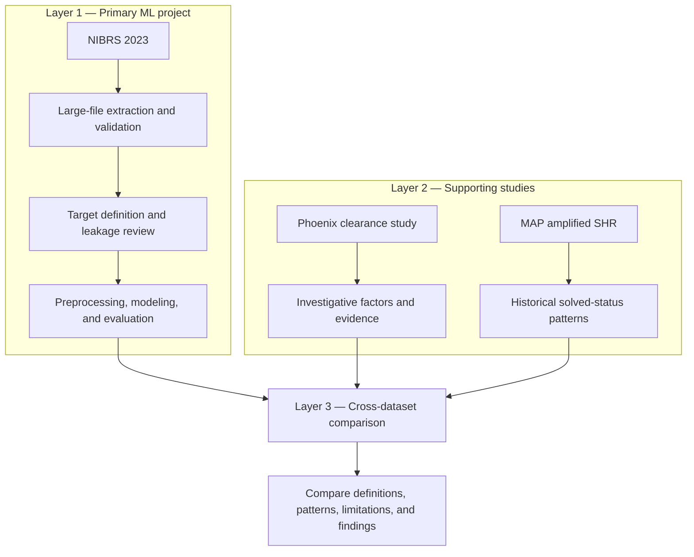

# Homicide Clearance Prediction in the United States

> **Project status:** Work in progress — data extraction is complete for the first dataset, and exploratory data analysis and target validation are underway.

## Project overview

This project investigates whether characteristics recorded about a homicide incident are associated with whether the case is cleared or remains uncleared in the United States.

The project is being developed as an end-to-end machine learning portfolio project. It will demonstrate data extraction, validation, cleaning, exploratory analysis, feature engineering, model development, evaluation, and responsible interpretation.

### Research question

**Can we predict whether a homicide incident will be cleared or remain uncleared using information available about the incident?**

A secondary goal is to identify characteristics associated with clearance. These relationships will be interpreted as associations, not as evidence that a characteristic causes a case to be solved.

## Current scope

The project is limited to homicide cases in the **United States**.

Development currently focuses on the 2023 National Incident-Based Reporting System (NIBRS) incident-level data. Two additional U.S. homicide datasets may be incorporated in later phases, but they have not yet been integrated into the analysis.

| Dataset | Intended role | Current status |
|---|---|---|
| NIBRS 2023 incident-level file | Primary dataset for building the initial nationwide workflow | In progress |
| Phoenix Homicide Clearance Initiative, 2003–2005 | Potential case study with explicit clearance outcomes and investigative variables | Future phase |
| Murder Accountability Project amplified Supplementary Homicide Reports | Potential historical comparison using reported solved status | Future phase |

These sources use different time periods, units of observation, geographic coverage, and definitions of clearance. They will not be combined until their outcome definitions and records can be compared responsibly.

## Three-layer project design

The datasets will play complementary roles rather than being merged automatically into one table.



### Layer 1: Primary ML project

NIBRS 2023 is the primary dataset for developing the end-to-end machine learning workflow. It provides the scale needed to demonstrate large-file processing, data validation, target construction, leakage-safe feature selection, model training, and evaluation.

### Layer 2: Supporting studies

The Phoenix dataset will support a focused analysis of investigative resources, evidence, and case outcomes. The MAP/SHR dataset may support a separate historical analysis of reported solved status. Each source will retain its own outcome definition and analytical pipeline.

### Layer 3: Cross-dataset comparison

The final stage will compare findings across the three analyses without assuming that *cleared*, *closed*, and *solved* mean exactly the same thing. The comparison will focus on compatible variables, recurring patterns, differences in outcome definitions, and the limitations of each source.

## Current dataset: NIBRS 2023

The active dataset is the incident-level file from **National Incident-Based Reporting System, 2023 (ICPSR 39270)**.

The original tab-separated file contains approximately:

- 12.35 million incident records
- 391 columns
- 11 GB of data

Because the source file is too large to load into memory at once, it is processed in chunks of 100,000 rows. Incidents whose first UCR offense code (`V20061`) is `91`, representing murder and nonnegligent manslaughter, are retained.

The resulting working dataset contains:

- **14,860 homicide incidents**
- **391 original columns**
- **41 initially selected variables** for data-quality review and exploratory analysis

Each row represents an incident rather than an individual victim.

## Work completed

- Read the 11 GB source file using chunked processing with pandas.
- Extracted incidents classified as murder or nonnegligent manslaughter.
- Saved a smaller working dataset for analysis.
- Identified constant columns and selected an initial set of relevant variables.
- Investigated blanks and special missing-value codes such as `-5`, `-6`, `-7`, `-8`, and `-9` using the data codebook.
- Examined whether missing city names could be recovered using the reporting agency identifier (`ORI`).
- Compared arrestee records (`RECSARR`) with exceptional-clearance reasons (`V1013`).
- Began reviewing possible target leakage.

## Current investigation: defining clearance

The machine learning target has **not yet been finalized**.

Two NIBRS variables are currently being examined:

- `RECSARR` — number of arrestee records associated with the incident
- `V1013` — reason an incident was cleared exceptionally

The initial cross-tabulation produced the following results:

| Arrestee record | Exceptional clearance | Incidents |
|---|---|---:|
| No | No | 7,212 |
| No | Yes | 595 |
| Yes | No | 7,053 |
| Yes | Yes | 0 |

This demonstrates that the absence of an arrest does not necessarily mean that a case was uncleared: 595 incidents contain an exceptional-clearance reason without an arrestee record.

These results are exploratory. The official meaning and timing of the fields must be verified before they are used to create the binary target.

## Target leakage

The intended prediction point is an important design decision. If the model is meant to make a prediction using information available near the time an incident is first reported, variables created later in the investigation cannot be used as input features.

For example, `RECSARR`, `V1013`, and an exceptional-clearance date may help define or validate the outcome, but they must not also be used as predictors. Candidate features will be reviewed according to whether they would have been available at the intended prediction time.

## Repository structure

```text
homicide-clearance-ml/
├── data/
│   ├── raw/              # Original source data stored locally
│   └── processed/        # Extracted working data
├── notebooks/
│   └── 01_nibrs_data_feasibility.ipynb
├── .gitignore
├── DATA_SOURCES.md
├── README.md
└── requirements.txt
```

## Reproducing the current analysis

1. Clone the repository and enter the project directory.
2. Create and activate a Python virtual environment.
3. Install the dependencies:

   ```bash
   pip install -r requirements.txt
   ```

4. Obtain the NIBRS 2023 incident-level file from ICPSR and place it at:

   ```text
   data/raw/39270-0003-Data.tsv
   ```

5. Open and run:

   ```text
   notebooks/01_nibrs_data_feasibility.ipynb
   ```

The source dataset is not distributed with this repository because of its size. Users should obtain it from the original provider and comply with the provider's terms of use.

## Planned work

- Verify and document the clearance target.
- Finish the missing-value and special-code review.
- Establish the intended prediction time.
- Remove variables that cause target leakage.
- Examine class balance and candidate-feature distributions.
- Build a simple baseline classifier.
- Compare additional classification models.
- Evaluate performance using appropriate classification metrics.
- Conduct error analysis and examine potential geographic and demographic bias.
- Evaluate the Phoenix and MAP/SHR datasets as separate supporting analyses before deciding whether any cross-dataset comparison is valid.

## Limitations and responsible use

Police administrative data reflect reporting practices, participation, recording decisions, investigative resources, and other institutional processes. A model trained on these data would learn patterns in recorded historical outcomes; it would not measure the inherent solvability or importance of a case.

Model results should not be interpreted causally or used to reduce investigative attention for cases predicted to have a lower probability of clearance. Demographic and geographic variables require particular care because they may reflect historical inequities in reporting and policing.

## Tools

- Python
- pandas
- NumPy
- Matplotlib
- Jupyter Notebook

## Data sources

The project currently uses the NIBRS 2023 incident-level file distributed by ICPSR. The Phoenix Homicide Clearance Initiative and Murder Accountability Project amplified SHR data are documented as possible sources for later, separate analyses; they have not yet been integrated into the model.

See [DATA_SOURCES.md](DATA_SOURCES.md) for dataset pages, DOIs, coverage periods, exact files, access information, and cross-dataset limitations.
