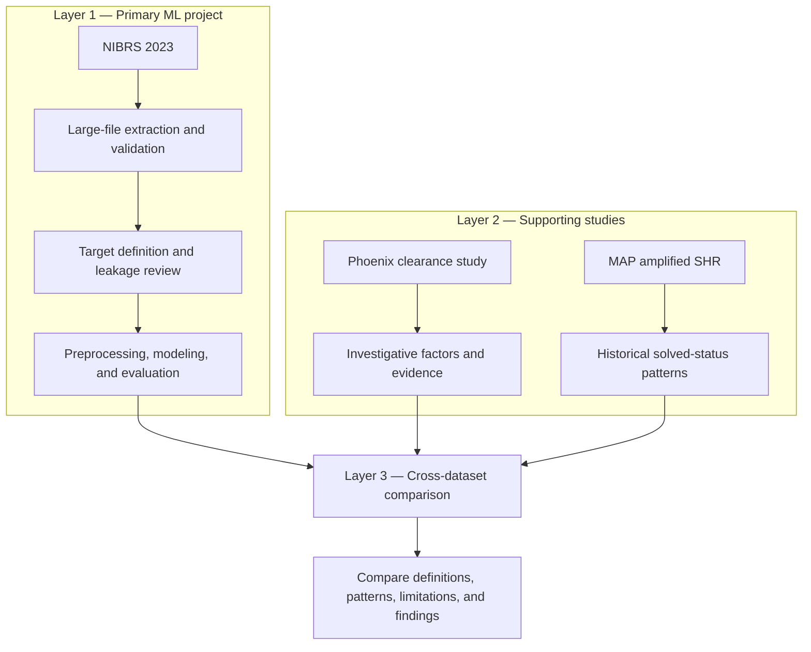

# Homicide Clearance Prediction in the United States

> **Project status:** Work in progress

| Date | What is done |
|---|---|
| October 11, 2026 | Extracted the NIBRS 2023 homicide incidents; completed initial data validation and missing-value investigation; began target-variable investigation; documented the three-layer project design and data sources. |

## Project overview

This project investigates whether characteristics recorded about a homicide incident are associated with whether the case is cleared or remains uncleared in the United States.

The project is being developed as an end-to-end machine learning portfolio project. It will demonstrate data extraction, validation, cleaning, exploratory analysis, feature engineering, model development, evaluation, and responsible interpretation.

### Research question

**Can we predict whether a homicide incident will be cleared or remain uncleared using information available about the incident?**

A secondary goal is to identify characteristics associated with clearance. These relationships will be interpreted as associations, not as evidence that a characteristic causes a case to be solved.

## Current scope

The project is limited to homicide cases in the **United States**.

Development currently focuses on the 2023 National Incident-Based Reporting System (NIBRS) incident-level data. Two additional U.S. homicide datasets may be incorporated in later phases, but they have not yet been integrated into the analysis.

| Dataset | Intended role | Current status |
|---|---|---|
| NIBRS 2023 incident-level file | Primary dataset for building the initial nationwide workflow | In progress |
| Phoenix Homicide Clearance Initiative, 2003–2005 | Potential case study with explicit clearance outcomes and investigative variables | Future phase |
| Murder Accountability Project amplified Supplementary Homicide Reports | Potential historical comparison using reported solved status | Future phase |

These sources use different time periods, units of observation, geographic coverage, and definitions of clearance. They will not be combined until their outcome definitions and records can be compared responsibly.

## Three-layer project design

The datasets will play complementary roles rather than being merged automatically into one table.



### Layer 1: Primary ML project

NIBRS 2023 is the primary dataset for developing the end-to-end machine learning workflow. It provides the scale needed to demonstrate large-file processing, data validation, target construction, leakage-safe feature selection, model training, and evaluation.

### Layer 2: Supporting studies

The Phoenix dataset will support a focused analysis of investigative resources, evidence, and case outcomes. The MAP/SHR dataset may support a separate historical analysis of reported solved status. Each source will retain its own outcome definition and analytical pipeline.

### Layer 3: Cross-dataset comparison

The final stage will compare findings across the three analyses without assuming that *cleared*, *closed*, and *solved* mean exactly the same thing. The comparison will focus on compatible variables, recurring patterns, differences in outcome definitions, and the limitations of each source.

## Setup

1. Clone the repository and enter the project directory.
2. Create and activate a Python virtual environment.
3. Install the dependencies:

   ```bash
   pip install -r requirements.txt
   ```

4. Obtain the NIBRS 2023 incident-level file from ICPSR and place it at:

   ```text
   data/raw/39270-0003-Data.tsv
   ```

5. Open and run:

   ```text
   notebooks/01_nibrs_data_feasibility.ipynb
   ```

The source dataset is not distributed with this repository because of its size. Users should obtain it from the original provider and comply with the provider's terms of use.

## Planned work

- Verify and document the clearance target.
- Finish the missing-value and special-code review.
- Establish the intended prediction time.
- Remove variables that cause target leakage.
- Examine class balance and candidate-feature distributions.
- Build a simple baseline classifier.
- Compare additional classification models.
- Evaluate performance using appropriate classification metrics.
- Conduct error analysis and examine potential geographic and demographic bias.
- Evaluate the Phoenix and MAP/SHR datasets as separate supporting analyses before deciding whether any cross-dataset comparison is valid.

## Data sources

The project currently uses the NIBRS 2023 incident-level file distributed by ICPSR. The Phoenix Homicide Clearance Initiative and Murder Accountability Project amplified SHR data are documented as possible sources for later, separate analyses; they have not yet been integrated into the model.

See [DATA_SOURCES.md](DATA_SOURCES.md) for dataset pages, DOIs, coverage periods, exact files, access information, and cross-dataset limitations.
